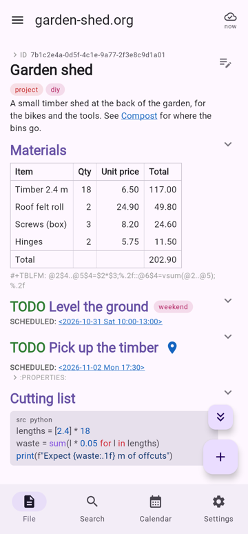
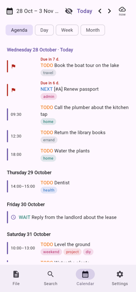
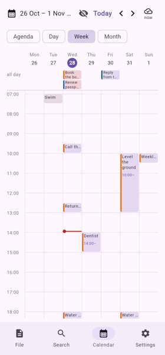
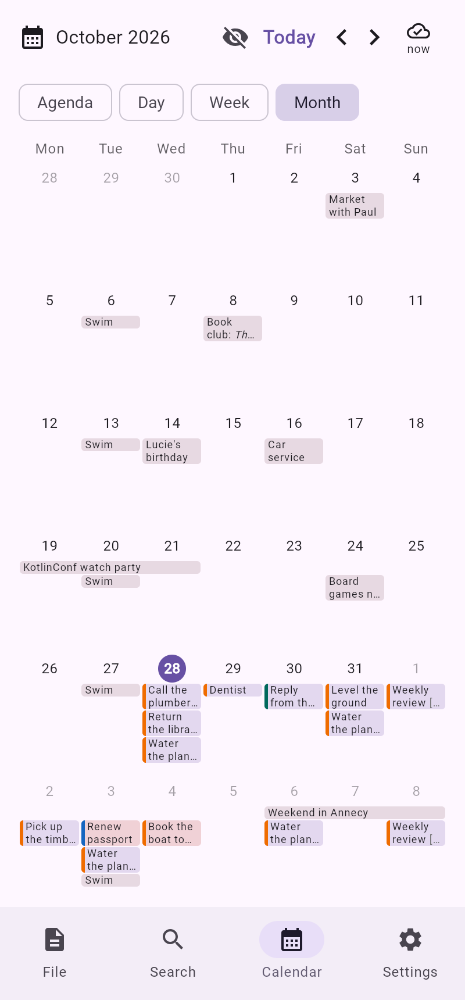

# KorgNote

KorgNote is an [Org-mode](https://orgmode.org) notes app with a calendar. It runs on Android, iOS,
desktop and the web, and syncs through a server you run yourself.

Your notes stay plain `.org` files in a folder. You can keep using Emacs, org-roam and git on them.

## Why

I keep my notes and tasks in Org files. On my phone, I tried Orgzly and Orgro, but they did not do
what I needed. I wanted one app where my notes and my calendar are the same thing. This is what I do
with emacs and Org Agenda.

This is a personal project that I use every day. Issues and pull requests are welcome, but I make no
promises about feature requests.

## Features

### Notes



- Headings, TODO keywords, priorities, tags, checkboxes, tables, drawers and code blocks.
- Links: `id:`, `file:`, headings and custom IDs, with backlinks.
- New notes and daily notes are created the same way org-roam creates them.
- Search by words and tags. Pin the notes you use most.

### Editing

- Tap a heading to edit it. Long-press to move, promote, demote or delete it.
- Suggestions above the keyboard for keywords, tags, dates and links.
- Change TODO states from a menu. Repeating tasks move to their next date when done.
- Edit tables as a grid. `#+TBLFM` formulas are computed the same way as in Emacs.

### Calendar

  

- Agenda, day, week and month views, built from `SCHEDULED`, `DEADLINE` and timestamps.
- Times, ranges, repeating events and multi-day events.
- Reminders and a morning summary on your phone, even offline.

### Sync

- Works offline. Changes sync when the server is reachable.
- Edits to the same note on two devices are merged. If they conflict, both versions are kept and you
  choose.
- Pair a phone by scanning a QR code. The connection uses TLS. No account or cloud service needed.

## Status

| Platform | Status |
|---|---|
| Android | Used every day |
| Server | Used every day (macOS, Docker) |
| Desktop | Works |
| Web | Works, on the same computer as the server |
| iOS | Builds and passes tests; not much tested on a real device |

There is no app store release yet. Each [release](https://github.com/jglouis/korgnote/releases/latest)
has the Android app, ready to install, and the server as a Docker image: see [Install](#install).
The iOS and desktop apps are built from source.

## How it works

```
  Your computer
  ┌────────────────────────────────────────────────────────────────┐
  │                                                                │
  │   notes folder  ◄────►  KorgNote server  ◄────  desktop app    │
  │   (~/notes/*.org)              ▲                or browser     │
  │                                │                               │
  └────────────────────────────────┼───────────────────────────────┘
                                   │  HTTPS, paired by QR code
                                   ▼
                          KorgNote on your phone
                   (its own copy of the notes, works offline)
```

KorgNote has two parts:

- **The server** runs on the computer that has your notes folder. It reads and writes the `.org`
  files directly; there is no database. You can run it with Docker or with Java. I run mine on my
  laptop, so there is no server to look after.
- **The apps** show and edit your notes. The phone app keeps its own copy, so it works offline. It
  saves your changes and syncs them as soon as it can reach the server. All traffic is encrypted with
  TLS, using a certificate the server creates for itself. The phone trusts it after you pair them
  with a QR code.

The desktop app and the web app only work on the same computer as the server, and need no pairing.

## What you need

| For | You need |
|---|---|
| The server | The computer with your notes, and [Docker](https://www.docker.com). To build it from source instead: JDK 25. |
| The Android app | An Android 7.0+ phone. To build it from source: the Android SDK ([Android Studio](https://developer.android.com/studio) is the easiest way to get it). |
| The web app | A browser, on the same computer as the server. The server comes with it. |
| The iOS app | An iPhone, and a Mac with Xcode to build it |
| The desktop app | JDK 25 to build it, on the same computer as the server |

The phone must be able to reach the computer: on the same Wi-Fi, or through a VPN such as
Tailscale or WireGuard. With a VPN, add the computer's VPN address on the Devices page before you
pair. When the computer is off or asleep, the phone keeps working and syncs later.

## Install

You do not need the source code: the server is a Docker image, and the Android app is an APK on the
release page.

1. **Start the server** on the computer that has your notes. Replace `~/notes` with your notes
   folder:

   ```shell
   mkdir -p ~/.korgnote-server
   docker run -d --name korgnote --restart unless-stopped \
     --user "$(id -u):$(id -g)" \
     -v ~/notes:/notes -v ~/.korgnote-server:/state \
     -p 8443:8443 -p 127.0.0.1:8080:8080 \
     ghcr.io/jglouis/korgnote-server:latest
   ```

   The image works on Intel and ARM computers (amd64 and arm64). It runs as your user, so new notes
   belong to you, and keeps its certificate and paired devices in `~/.korgnote-server`.

2. **Open <http://localhost:8080/devices>.** Under *Addresses the phone can reach this computer at*,
   enter this computer's address on your network, for example `192.168.1.20`. The server cannot
   find it from inside Docker. To see it, run `ipconfig getifaddr en0` on a Mac or `hostname -I` on
   Linux. Then click **Show a pairing code**. The address is only needed while you pair a phone, and
   the server forgets it when it restarts; to give it at startup instead, add
   `-e KORGNOTE_ADVERTISED_ADDRESSES=192.168.1.20` to the `docker run` command.

3. **Install the app on your phone.** On the phone, open the
   [latest release](https://github.com/jglouis/korgnote/releases/latest) and download
   `korgnote-X.Y.Z.apk`. Open it, and allow your browser to install apps when Android asks.

4. **Pair.** In the app, go to **Settings → Pair with a computer** and scan the code.

The web app is at <http://localhost:8080/>, on the same computer as the server.

### Update

- **The app:** download the new APK from the release page and install it. It replaces the old one
  and keeps your notes.
- **The server:** get the new image, then start it again with the same `docker run` command as
  above:

  ```shell
  docker pull ghcr.io/jglouis/korgnote-server:latest
  docker rm -f korgnote
  ```

  Your notes and paired devices are kept, since they are in your folders, not in the container.

To stay on one version, use its number instead of `latest`, for example
`ghcr.io/jglouis/korgnote-server:1.1.0`. Each release says what changed.

### Build from source instead

1. Start the server on the computer that has your notes:

   ```shell
   scripts/run-server-container.sh ~/notes     # with Docker, built from your checkout
   NOTES_DIR=~/notes ./gradlew :server:run      # with Java
   ```

2. Open <http://localhost:8080/devices> and click **Show a pairing code**.
3. Connect your phone by USB, with USB debugging turned on, and install the app:

   ```shell
   ./gradlew :androidApp:installDebug
   ```

   This installs *KorgNote Debug*, a separate app from the one on the release page.

4. In the app, go to **Settings → Pair with a computer** and scan the code.

To use the desktop app instead of a phone, run `./gradlew :composeApp:run` on the same computer as
the server. No pairing is needed. See [Development](#development) for more.

## License

KorgNote is licensed under the [GNU General Public License v3.0](LICENSE) or later.

---

## Development

KorgNote is a [Kotlin Multiplatform](https://www.jetbrains.com/help/kotlin-multiplatform-dev/get-started.html)
project with a Compose Multiplatform UI and a Ktor server. Design notes are in [docs/](docs/README.md).

| Module | Contents |
|---|---|
| [shared/](shared/src) | Org parser, agenda and table formulas |
| [composeApp/](composeApp/src) | The app UI and sync client, for all platforms |
| [androidApp/](androidApp) | Android app |
| [iosApp/](iosApp/iosApp) | iOS app (open in Xcode) |
| [server/](server/src/main/kotlin) | Sync server, also serves the web app |

On Windows, use `gradlew.bat` instead of `./gradlew`.

### Android

```shell
./gradlew :androidApp:assembleDebug
```

The debug build installs as a separate app, *KorgNote Debug* (`com.korgnote.androidapp.debug`).

#### Release build

The signing key is stored in KeePassXC. The script asks for the database password, builds a signed
APK and prints the certificate's SHA-256:

```shell
scripts/release.sh ~/path/to/database.kdbx      # or set KORGNOTE_KDBX
adb -s <serial> install -r androidApp/build/outputs/apk/release/androidApp-release.apk
```

By default, the keystore is the attachment `korgnote-release.jks` on the entry *Korgnote keystore*.
The entry's username is the key alias and its password is the keystore password. To change this,
set `KORGNOTE_KDBX_ENTRY` and `KORGNOTE_KDBX_ATTACHMENT`. If the database also needs a key file, set
`KORGNOTE_KDBX_KEYFILE`.

#### Release build without KeePassXC

Create a keystore once, and keep it and its password safe. Every update must be signed with the
same key:

```shell
keytool -genkeypair -v -keystore ~/korgnote-release.jks -alias korgnote \
  -keyalg RSA -keysize 4096 -validity 10000
```

Then build, giving Gradle the keystore and its password:

```shell
read -rs "pw?Keystore password: "; echo      # in bash: read -rsp "Keystore password: " pw
ORG_GRADLE_PROJECT_KORGNOTE_STORE_FILE=~/korgnote-release.jks \
ORG_GRADLE_PROJECT_KORGNOTE_STORE_PASSWORD="$pw" \
ORG_GRADLE_PROJECT_KORGNOTE_KEY_ALIAS=korgnote \
ORG_GRADLE_PROJECT_KORGNOTE_KEY_PASSWORD="$pw" \
  ./gradlew :androidApp:assembleRelease --no-configuration-cache
```

The APK is at `androidApp/build/outputs/apk/release/androidApp-release.apk`. Keep
`--no-configuration-cache`, or Gradle saves the passwords in its cache. Without a keystore, the build
makes an unsigned APK that Android will not install.

An APK signed with a different key cannot update an installed app. You must uninstall it first,
which deletes the notes stored in the app, so sync before you do.

Increase `versionCode` in `androidApp/build.gradle.kts` for each release.

To do all of a release in one go, use `scripts/publish.sh`. It raises the version (in the iOS
project too, though the iOS app is not released), runs the tests, builds the signed APK with
`scripts/release.sh`, commits and tags the new version, and pushes them. The tag makes GitHub build
the server's Docker image for amd64 and arm64. The script puts the APK on a draft GitHub release,
waits for the image, and then publishes the release. It shows you the plan, with the release notes,
before it changes anything:

```shell
scripts/publish.sh --dry-run minor ~/Passwords.kdbx   # see the plan, change nothing
scripts/publish.sh minor ~/Passwords.kdbx             # patch, minor, major, or a version like 1.4.0
scripts/publish.sh current ~/Passwords.kdbx           # the version is already raised by hand
```

Before a release, write what changed for the people using the app in `docs/releases/X.Y.Z.md`
(see [1.1.0](docs/releases/1.1.0.md)), one line per paragraph or item, since GitHub shows each line
break. The script uses it as the release notes; without it, the notes are the titles of the commits
since the last release.

`--no-push` stops before the push, `--draft` leaves the release a draft for you to publish,
`--no-wait` publishes it without waiting for the image, and `--edit-notes` lets you edit the notes
first. The script will not publish an APK signed with a key other than the release key, which could
not update the app. If the image build fails, the release stays a draft and the script tells you how
to retry. It needs the GitHub CLI, logged in with `gh auth login`.

### Desktop

```shell
./gradlew :composeApp:run
```

### iOS

Open [iosApp/](iosApp) in Xcode and run it.

### Web

Build the web app, then start the server. The server serves it at <http://localhost:8080/>.

```shell
./gradlew :composeApp:wasmJsBrowserDistribution
```

### Server

```shell
./gradlew :server:run
```

The server uses two ports:

- **8080 (HTTP)** for this computer only: the web app, the desktop app and the Devices page. It
  listens on `127.0.0.1` and has no password, so never expose it to the network.
- **8443 (HTTPS)** for paired devices. The server creates its own certificate on first start, and
  devices trust it by its fingerprint.

To pair a device, open <http://localhost:8080/devices>, click **Show a pairing code** and scan it in
the app under **Settings → Pair with a computer**. `scripts/pair.sh` shows the same code in the
terminal. You can also revoke devices from the Devices page.

The certificate and the list of paired devices are stored in `~/.korgnote-server`. If you delete
this folder, every device must pair again.

| Variable | Meaning |
|---|---|
| `NOTES_DIR` | Folder with your `.org` files. Without it, the server shows sample notes. |
| `KORGNOTE_PORT` | HTTP port. Default: 8080. |
| `KORGNOTE_HTTP_HOST` | Address the HTTP port listens on. Default: `127.0.0.1`. |
| `KORGNOTE_HTTPS_PORT` | HTTPS port for paired devices. Default: 8443. |
| `KORGNOTE_ADVERTISED_PORT` | HTTPS port put in pairing codes, if different from the real one. |
| `KORGNOTE_ADVERTISED_ADDRESSES` | Addresses put in pairing codes, separated by commas. Found automatically outside Docker. |
| `KORGNOTE_SERVER_NAME` | Name shown to paired devices. |
| `KORGNOTE_STATE_DIR` | Where the certificate and devices are stored. Default: `~/.korgnote-server`. |
| `KORGNOTE_DISABLE_WEB` | Set to `1` to not serve the web app. |
| `KORGNOTE_REQUIRE_NOTES_DIR` | Set to `1` to stop if `NOTES_DIR` is missing or not writable. |

#### Docker

```shell
scripts/run-server-container.sh ~/notes     # add -d to run in the background
```

The script saves the notes folder in `.env` and passes your computer's name and addresses to the
container. Port 8443 is open to the network; port 8080 is only open on `127.0.0.1`. The container
stops if the notes folder is missing, and runs as your user so new notes belong to you. To change
the ports, set `KORGNOTE_HOST_PORT` and `KORGNOTE_HTTPS_HOST_PORT`.

The script builds the image from your checkout. Each release also publishes one, for amd64 and
arm64, at `ghcr.io/jglouis/korgnote-server` (tagged `latest`, and by version, such as `1.1.0`); see
[Install](#install) to run it.

Changes you make to the notes on the computer, for example in Emacs, show up in the app right away.

### Tests

Run all tests:

```shell
./gradlew allTests :server:test --continue
```

Run one part only:

```shell
./gradlew :shared:jvmTest
./gradlew :composeApp:jvmTest
./gradlew :shared:iosSimulatorArm64Test
./gradlew :shared:wasmJsTest
./gradlew :server:test --tests 'com.korgnote.server.FileStoreTest'
```

Reports are in `<module>/build/reports/tests/`.

To run tests again even if nothing changed:

```shell
./gradlew :shared:jvmTest --rerun                                                            # one task
./gradlew cleanAllTests allTests :server:cleanTest :server:test --no-build-cache --continue  # all tests
```

On macOS, the iOS tests need the full Xcode. If they fail with `unable to find utility "simctl"`,
run:

```shell
sudo xcode-select -s /Applications/Xcode.app/Contents/Developer
```
