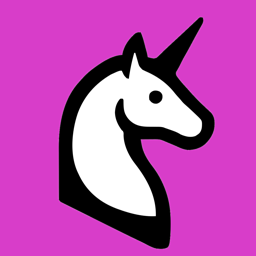
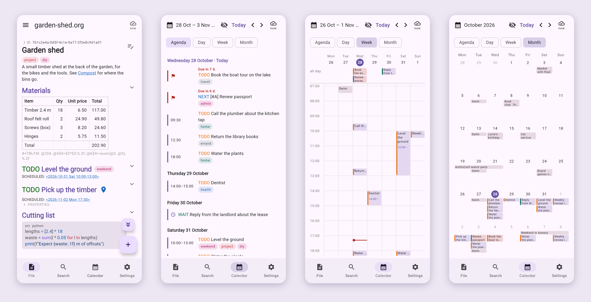

<p align="center">
  
</p>

<h1 align="center">KorgNote</h1>

<p align="center">
  The power of <a href="https://orgmode.org">Org-mode</a> on your phone.<br>
  Text edition, agenda and calendar view.
</p>

<p align="center">
  <a href="https://github.com/jglouis/korgnote/releases/latest"><b>Download the Android app</b></a>
</p>



## Your notes are your calendar

In Emacs, Org Agenda makes your notes and your calendar the same thing. KorgNote does that on the
phone: there is no calendar to keep apart from your notes, and nothing to copy between them.

- **From a heading to its day, and back.** Tap the `SCHEDULED` or `DEADLINE` date of a heading to
  open that day in the calendar. Tap any entry in the calendar to open its note at that heading,
  to read it, edit it or mark it done.
- **A real calendar, not just a list.** The agenda, with what is overdue on top, then a day and a
  week on an hour grid you can pinch to zoom, and a month. Built from `SCHEDULED`, `DEADLINE` and
  plain timestamps, with times, ranges, repeats, deadline warnings and events over several days.
- **Reminders** before each timed entry, 10 minutes ahead or as long as you choose. Tap one to open
  its heading.
- **A morning digest:** one notification, at the time you choose, with the day's agenda. Turn it on
  in **Settings → Reminders**.
- **Home-screen widgets** on Android: the agenda, and the month. Tap an entry to open its heading,
  or a day to open the calendar there.
- **Even offline:** reminders and the digest are scheduled on the phone, from your notes. Nothing
  goes through a server, so they come with no network and the app closed.

## Get started

1. **Install the app.** On an Android phone (7.0 or later), open the
   [latest release](https://github.com/jglouis/korgnote/releases/latest), download
   `korgnote-X.Y.Z.apk` and open it. Allow your browser to install apps when Android asks.
2. **Open it and choose where your notes are.** There are three ways:

|  | [A folder on the phone](#a-folder-on-the-phone) | [A WebDAV server](#a-webdav-server-experimental) (experimental) | [Your computer, with the KorgNote server](#your-computer-with-the-korgnote-server) |
|---|---|---|---|
| **Pick it if** | you want to try the app, or already sync a folder | you have Nextcloud, a NAS or a hosting service | your notes live on your computer |
| **You need** | nothing else | the server's address, a user name and a password | Docker on the computer, and the phone on its Wi-Fi or a VPN |
| **A note edited on two devices** | the syncing app keeps a conflict copy | merged | merged |

All three work offline, and you can change your mind later in **Settings → Change where notes
are**.

### A folder on the phone

Choose **A folder on this device** and pick the folder your `.org` files are in, or an empty one.

- On Android, keep it in sync with Syncthing, or with Dropbox and others through an app like
  FolderSync.
- On an iPhone, the folder can be in iCloud Drive, or in Dropbox and other apps that show in Files.
- Or sync it with nothing, if the phone is the only place you take notes.

### A WebDAV server (experimental)

1. On the server, make a folder for your notes, or use the one they are in.
2. In the app, choose **A WebDAV server (experimental)** and fill in:

   | Field | What to enter |
   |---|---|
   | Folder address | The folder's WebDAV address, starting with `https://`. On Nextcloud: `https://your.cloud/remote.php/dav/files/USER/notes`. The start of it is under **Files → Files settings → WebDAV**; add your folder's name. |
   | User name | Your user name on the server. |
   | Password | An app password, if the server offers them. On Nextcloud: **Personal settings → Security → Devices & sessions → Create new app password**. |

3. Tap **Check the server**, then **Use this server**.

The check writes a hidden file, `.korgnote-check`, and deletes it again. It makes sure the server
refuses a write over a newer version of a file, which is what stops one device from overwriting
another's edit. A server that does not, such as `rclone serve webdav`, is refused.

Good to know:

- **Experimental:** tested with Nextcloud and Apache, not yet with NAS or hosting services. Please
  [report](https://github.com/jglouis/korgnote/issues) what works and what does not.
- **HTTPS only**, with a certificate the phone already trusts: not a self-signed one.
- **User name and password only** (Basic sign-in). If the server asks for another way, such as
  Digest, the app says which.
- The password is kept in the Android Keystore or the iPhone's Keychain, and is in no backup.
- Changes made elsewhere show up within about 30 seconds while the app is open.

### Your computer, with the KorgNote server

The server runs on the computer that has your notes folder. It reads and writes the `.org` files
directly; there is no database. The phone pairs with it by QR code, and they talk over TLS.

1. **Start the server.** Replace `~/notes` with your notes folder:

   ```shell
   mkdir -p ~/.korgnote-server
   docker run -d --name korgnote --restart unless-stopped \
     --user "$(id -u):$(id -g)" \
     -v ~/notes:/notes -v ~/.korgnote-server:/state \
     -p 8443:8443 -p 127.0.0.1:8080:8080 \
     ghcr.io/jglouis/korgnote-server:latest
   ```

   It works on Intel and ARM computers, runs as your user so new notes belong to you, and keeps its
   certificate and paired devices in `~/.korgnote-server`.

2. **Open <http://localhost:8080/devices>.** Under *Addresses the phone can reach this computer at*,
   enter this computer's address, for example `192.168.1.20` (run `ipconfig getifaddr en0` on a Mac,
   `hostname -I` on Linux). Then click **Show a pairing code**.
3. **In the app,** choose **My computer, with the KorgNote server** and scan the code.

The phone must reach the computer: on the same Wi-Fi, or through a VPN such as Tailscale or
WireGuard, whose address you add on the Devices page before pairing. When the computer is off or
asleep, the phone keeps working and syncs later.

The server also gives you the **web app**, at <http://localhost:8080/>, and the **desktop app**
(built from source, see [Development](#development)) on the same computer.

To give the address at startup rather than on the Devices page, add
`-e KORGNOTE_ADVERTISED_ADDRESSES=192.168.1.20` to the `docker run` command.

## What else it does

- **Your files stay yours:** the app reads and writes plain `.org` files and nothing else. An edit
  rewrites only what you changed and leaves the rest of the file as it was, so Emacs, org-roam and
  git keep working on your notes.
- **Notes:** headings, TODO keywords, priorities, tags, checkboxes, tables, drawers and code blocks.
- **Links:** `id:`, `file:`, headings and custom IDs, with backlinks. New notes and daily notes are
  made the way org-roam makes them.
- **Editing:** tap a heading to edit it, long-press to move, promote, demote or delete it.
  Suggestions above the keyboard for keywords, tags, dates and links.
- **Tasks:** change TODO states from a menu. Repeating tasks move to their next date when done.
- **Tables:** edit them as a grid. `#+TBLFM` formulas are computed the same way as in Emacs.
- **Search** by words and tags, save searches by name, and pin the notes you use most.
- **Offline first:** the app keeps working without a connection and syncs when it can.

## Updating

- **The app:** download the new APK from the [release page](https://github.com/jglouis/korgnote/releases/latest)
  and install it over the old one. Your notes are kept.
- **The server:** get the new image, then run the same `docker run` command again:

  ```shell
  docker pull ghcr.io/jglouis/korgnote-server:latest
  docker rm -f korgnote
  ```

  Your notes and paired devices are kept. To stay on one version, use its number instead of
  `latest`, for example `ghcr.io/jglouis/korgnote-server:1.1.0`.

## A new phone, and backups

The app's copy of your notes stays on the phone: it is in no Android or iPhone backup, and is not
moved to a new phone, nor are the pairing and the WebDAV password. On a new phone, choose again
where your notes are, and they sync. Notes in a folder of yours are wherever that folder is.

## Status

| Platform | Status |
|---|---|
| Android | Used every day. The APK is on each [release](https://github.com/jglouis/korgnote/releases/latest). |
| Server | Used every day (macOS, Docker). The image is `ghcr.io/jglouis/korgnote-server`. |
| Desktop | Works, on the same computer as the server. Built from source. |
| Web | Works, on the same computer as the server. |
| iOS | Builds and passes tests; not much tested on a real iPhone. Built from source. |

There is no app store release yet.

## About

I keep my notes and tasks in Org files. On my phone, I tried Orgzly and Orgro, but they did not do
what I needed: one app where my notes and my calendar are the same thing, as they are in Emacs with
Org Agenda. This is a personal project that I use every day. Issues and pull requests are welcome,
but I make no promises about feature requests.

I started KorgNote by hand in 2025, to learn Compose Multiplatform. Since September 2026, most of
the code has been written with [Claude Code](https://claude.com/claude-code), an AI coding agent,
and it has rewritten much of the earlier code too. I decide what gets built, and I use it every day
on my own notes. The parser, sync and editor are covered by automated tests. Commits written with
Claude say so in a `Co-Authored-By` line.

## License

KorgNote is licensed under the [GNU General Public License v3.0](LICENSE) or later.

---

## Development

KorgNote is a [Kotlin Multiplatform](https://www.jetbrains.com/help/kotlin-multiplatform-dev/get-started.html)
project with a Compose Multiplatform UI and a Ktor server. Design notes are in [docs/](docs/README.md).

| Module | Contents |
|---|---|
| [shared/](shared/src) | Org parser, agenda and table formulas |
| [composeApp/](composeApp/src) | The app UI and sync client, for all platforms |
| [androidApp/](androidApp) | Android app |
| [iosApp/](iosApp/iosApp) | iOS app (open in Xcode) |
| [server/](server/src/main/kotlin) | Sync server, also serves the web app |

| To build | You need |
|---|---|
| The Android app | The Android SDK ([Android Studio](https://developer.android.com/studio) is the easiest way to get it) |
| The server | JDK 25, or Docker |
| The iOS app | A Mac with Xcode |
| The desktop app | JDK 25 |

On Windows, use `gradlew.bat` instead of `./gradlew`.

### Run it from your checkout

1. Start the server on the computer that has your notes:

   ```shell
   scripts/run-server-container.sh ~/notes     # with Docker, built from your checkout
   NOTES_DIR=~/notes ./gradlew :server:run      # with Java
   ```

2. Open <http://localhost:8080/devices> and click **Show a pairing code**.
3. Connect your phone by USB, with USB debugging turned on, and install the app:

   ```shell
   ./gradlew :androidApp:installDebug
   ```

   This installs *KorgNote Debug*, a separate app from the one on the release page.

4. Open the app, choose **My computer, with the KorgNote server**, and scan the code.

To use the desktop app instead of a phone, run `./gradlew :composeApp:run` on the same computer as
the server. No pairing is needed.

### Android

```shell
./gradlew :androidApp:assembleDebug
```

The debug build installs as a separate app, *KorgNote Debug* (`com.korgnote.androidapp.debug`).

#### Release build

The signing key is stored in KeePassXC. The script asks for the database password, builds a signed
APK and prints the certificate's SHA-256:

```shell
scripts/release.sh ~/path/to/database.kdbx      # or set KORGNOTE_KDBX
adb -s <serial> install -r androidApp/build/outputs/apk/release/androidApp-release.apk
```

By default, the keystore is the attachment `korgnote-release.jks` on the entry *Korgnote keystore*.
The entry's username is the key alias and its password is the keystore password. To change this,
set `KORGNOTE_KDBX_ENTRY` and `KORGNOTE_KDBX_ATTACHMENT`. If the database also needs a key file, set
`KORGNOTE_KDBX_KEYFILE`.

#### Release build without KeePassXC

Create a keystore once, and keep it and its password safe. Every update must be signed with the
same key:

```shell
keytool -genkeypair -v -keystore ~/korgnote-release.jks -alias korgnote \
  -keyalg RSA -keysize 4096 -validity 10000
```

Then build, giving Gradle the keystore and its password:

```shell
read -rs "pw?Keystore password: "; echo      # in bash: read -rsp "Keystore password: " pw
ORG_GRADLE_PROJECT_KORGNOTE_STORE_FILE=~/korgnote-release.jks \
ORG_GRADLE_PROJECT_KORGNOTE_STORE_PASSWORD="$pw" \
ORG_GRADLE_PROJECT_KORGNOTE_KEY_ALIAS=korgnote \
ORG_GRADLE_PROJECT_KORGNOTE_KEY_PASSWORD="$pw" \
  ./gradlew :androidApp:assembleRelease --no-configuration-cache
```

The APK is at `androidApp/build/outputs/apk/release/androidApp-release.apk`. Keep
`--no-configuration-cache`, or Gradle saves the passwords in its cache. Without a keystore, the build
makes an unsigned APK that Android will not install.

An APK signed with a different key cannot update an installed app. You must uninstall it first,
which deletes the notes stored in the app, so sync before you do.

Increase `versionCode` in `androidApp/build.gradle.kts` for each release.

To do all of a release in one go, use `scripts/publish.sh`. It raises the version (in the iOS
project too, though the iOS app is not released), runs the tests, builds the signed APK with
`scripts/release.sh`, commits and tags the new version, and pushes them. The tag makes GitHub build
the server's Docker image for amd64 and arm64. The script puts the APK on a draft GitHub release,
waits for the image, and then publishes the release. It shows you the plan, with the release notes,
before it changes anything:

```shell
scripts/publish.sh --dry-run minor ~/Passwords.kdbx   # see the plan, change nothing
scripts/publish.sh minor ~/Passwords.kdbx             # patch, minor, major, or a version like 1.4.0
scripts/publish.sh current ~/Passwords.kdbx           # the version is already raised by hand
```

Before a release, write what changed for the people using the app in `docs/releases/X.Y.Z.md`
(see [1.1.0](docs/releases/1.1.0.md)), one line per paragraph or item, since GitHub shows each line
break. The script uses it as the release notes; without it, the notes are the titles of the commits
since the last release.

`--no-push` stops before the push, `--draft` leaves the release a draft for you to publish,
`--no-wait` publishes it without waiting for the image, and `--edit-notes` lets you edit the notes
first. The script will not publish an APK signed with a key other than the release key, which could
not update the app. If the image build fails, the release stays a draft and the script tells you how
to retry. It needs the GitHub CLI, logged in with `gh auth login`.

### Desktop

```shell
./gradlew :composeApp:run
```

### iOS

Open [iosApp/](iosApp) in Xcode and run it.

### Web

Build the web app, then start the server. The server serves it at <http://localhost:8080/>.

```shell
./gradlew :composeApp:wasmJsBrowserDistribution
```

### Server

```shell
./gradlew :server:run
```

The server uses two ports:

- **8080 (HTTP)** for this computer only: the web app, the desktop app and the Devices page. It
  listens on `127.0.0.1` and has no password, so never expose it to the network.
- **8443 (HTTPS)** for paired devices. The server creates its own certificate on first start, and
  devices trust it by its fingerprint.

To pair a device, open <http://localhost:8080/devices>, click **Show a pairing code** and scan it in
the app, on its first start or later under **Settings → Pair with a computer**. `scripts/pair.sh`
shows the same code in the terminal. You can also revoke devices from the Devices page.

The certificate and the list of paired devices are stored in `~/.korgnote-server`. If you delete
this folder, every device must pair again.

| Variable | Meaning |
|---|---|
| `NOTES_DIR` | Folder with your `.org` files. Without it, the server shows sample notes. |
| `KORGNOTE_PORT` | HTTP port. Default: 8080. |
| `KORGNOTE_HTTP_HOST` | Address the HTTP port listens on. Default: `127.0.0.1`. |
| `KORGNOTE_HTTPS_PORT` | HTTPS port for paired devices. Default: 8443. |
| `KORGNOTE_ADVERTISED_PORT` | HTTPS port put in pairing codes, if different from the real one. |
| `KORGNOTE_ADVERTISED_ADDRESSES` | Addresses put in pairing codes, separated by commas. Found automatically outside Docker. |
| `KORGNOTE_SERVER_NAME` | Name shown to paired devices. |
| `KORGNOTE_STATE_DIR` | Where the certificate and devices are stored. Default: `~/.korgnote-server`. |
| `KORGNOTE_DISABLE_WEB` | Set to `1` to not serve the web app. |
| `KORGNOTE_REQUIRE_NOTES_DIR` | Set to `1` to stop if `NOTES_DIR` is missing or not writable. |

#### Docker

```shell
scripts/run-server-container.sh ~/notes     # add -d to run in the background
```

The script saves the notes folder in `.env` and passes your computer's name and addresses to the
container. Port 8443 is open to the network; port 8080 is only open on `127.0.0.1`. The container
stops if the notes folder is missing, and runs as your user so new notes belong to you. To change
the ports, set `KORGNOTE_HOST_PORT` and `KORGNOTE_HTTPS_HOST_PORT`.

The script builds the image from your checkout. Each release also publishes one, for amd64 and
arm64, at `ghcr.io/jglouis/korgnote-server` (tagged `latest`, and by version, such as `1.1.0`); see
[Your computer, with the KorgNote server](#your-computer-with-the-korgnote-server) to run it.

Changes you make to the notes on the computer, for example in Emacs, show up in the app right away.

### WebDAV test servers

`scripts/webdav-test-servers.sh` starts the servers the WebDAV sync is tested against, in Docker:
Apache, rclone and Nextcloud. It prints the line that runs the tests against them:

```shell
eval "$(scripts/webdav-test-servers.sh)"
./gradlew :composeApp:jvmTest --tests '*WebDavServersTest*'
scripts/webdav-test-servers.sh stop
```

### Tests

Run all tests:

```shell
./gradlew allTests :server:test --continue
```

Run one part only:

```shell
./gradlew :shared:jvmTest
./gradlew :composeApp:jvmTest
./gradlew :shared:iosSimulatorArm64Test
./gradlew :shared:wasmJsTest
./gradlew :server:test --tests 'com.korgnote.server.FileStoreTest'
```

Reports are in `<module>/build/reports/tests/`.

To run tests again even if nothing changed:

```shell
./gradlew :shared:jvmTest --rerun                                                            # one task
./gradlew cleanAllTests allTests :server:cleanTest :server:test --no-build-cache --continue  # all tests
```

On macOS, the iOS tests need the full Xcode. If they fail with `unable to find utility "simctl"`,
run:

```shell
sudo xcode-select -s /Applications/Xcode.app/Contents/Developer
```
